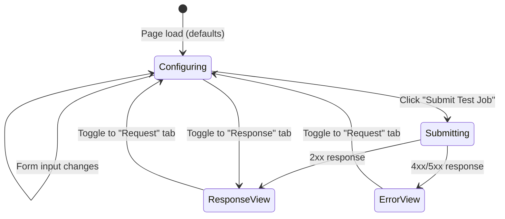

# Data Model: Playground Tab

**Feature Branch**: `004-playground-tab`
**Date**: 2026-04-06

> The Playground feature is primarily client-side. No new database tables or migrations
> are required. All entities below are transient in-memory structures.

---

## Client-Side Entities (TypeScript)

### PlaygroundFormState

The top-level form state object managed by `usePlaygroundForm` hook via `useReducer`.

| Field | Type | Default | Description |
|---|---|---|---|
| `source_url` | `string` | `""` | Source video URL input |
| `output_format` | `"mp4" \| "hls"` | `"mp4"` | Output format selector |
| `preset` | `"tiktok" \| "youtube" \| "instagram" \| null` | `null` | Social-media preset |
| `generate_subtitles` | `boolean` | `false` | Subtitle generation toggle |
| `webhook_url` | `string` | `""` | Optional webhook URL |
| `hls_config` | `HlsConfigState` | *(see below)* | HLS-specific options; relevant only when `output_format === "hls"` |

### HlsConfigState

Nested HLS configuration. Rendered conditionally when `output_format === "hls"`.

| Field | Type | Default | Constraints | Description |
|---|---|---|---|---|
| `segment_duration` | `number` | `10` | 2–30 | Segment duration in seconds |
| `video_codec_preset` | `CodecPreset` | `"fast"` | enum (9 values) | libx264 encoding preset |
| `video_crf` | `number` | `23` | 0–51 | Constant Rate Factor |
| `video_profile` | `"baseline" \| "main" \| "high"` | `"high"` | — | H.264 profile |
| `renditions` | `RenditionState[]` | `[]` | unique names | Custom quality renditions |

### RenditionState

A single HLS rendition entry.

| Field | Type | Required | Constraints | Description |
|---|---|---|---|---|
| `id` | `string` | Yes | UUID (client-gen) | Unique key for React list rendering |
| `name` | `string` | Yes | `^[a-zA-Z0-9_\-]+$`, unique | Rendition name (e.g., "720p") |
| `width` | `number` | Yes | > 0 | Video width in pixels |
| `height` | `number` | Yes | > 0 | Video height in pixels |
| `video_bitrate` | `string` | Yes | e.g., "2500k" | Target video bitrate |
| `audio_bitrate` | `string` | No | default "128k" | Target audio bitrate |

### CodecPreset (union type)

```typescript
type CodecPreset =
  | "ultrafast" | "superfast" | "veryfast" | "faster" | "fast"
  | "medium" | "slow" | "slower" | "veryslow"
```

---

## Derived Entities

### RequestPreviewPayload

A derived JSON object computed from `PlaygroundFormState`. This matches the `JobCreate` Pydantic schema on the backend. Fields at their default values are **omitted** per FR-014.

```typescript
interface RequestPreviewPayload {
  source_url: string                           // always present; placeholder if empty
  output_format?: "mp4" | "hls"               // omitted when "mp4" (default)
  preset?: "tiktok" | "youtube" | "instagram" // omitted when null
  generate_subtitles?: boolean                 // omitted when false
  webhook_url?: string                         // omitted when empty
  hls_config?: {                               // omitted when output_format !== "hls"
    segment_duration?: number                  // omitted when 10
    video_codec_preset?: string                // omitted when "fast"
    video_crf?: number                         // omitted when 23
    video_profile?: string                     // omitted when "high"
    renditions?: Array<{                       // omitted when empty
      name: string
      width: number
      height: number
      video_bitrate: string
      audio_bitrate?: string                   // omitted when "128k"
    }>
  }
}
```

### TestJobResponse

Returned from `POST /api/v1/playground/test-job`. Mirrors the existing `JobResponse` schema.

```typescript
interface TestJobResponse {
  id: string          // UUID
  status: string      // "pending"
  source_url: string
  output_format: string
  preset: string | null
  generate_subtitles: boolean
  webhook_url: string | null
  hls_config: object | null
  created_at: string  // ISO 8601
  updated_at: string  // ISO 8601
}
```

---

## Backend Entities (Pydantic Schemas — new file)

### TestJobRequest

Reuses the existing `JobCreate` schema fields but is defined as a separate schema for the playground endpoint to allow future divergence.

```python
class TestJobRequest(BaseModel):
    source_url: str
    preset: Optional[Literal["tiktok", "youtube", "instagram"]] = None
    output_format: Optional[Literal["mp4", "hls"]] = "mp4"
    webhook_url: Optional[HttpUrl] = None
    generate_subtitles: Optional[bool] = False
    hls_config: Optional[HLSConfig] = None
```

> **Note**: `TestJobRequest` deliberately mirrors `JobCreate` field-for-field. It is a separate
> class to (a) decouple the playground contract from the public API contract and (b) allow
> adding playground-specific fields in the future (e.g., `dry_run`).

---

## State Transitions



---

## Validation Rules

| Rule | Scope | Error Display |
|---|---|---|
| Source URL must be valid URL format | Form (submit gate) | Inline below input |
| Rendition names must be unique | HLS renditions list | Inline on duplicate entry |
| Rendition name pattern: `^[a-zA-Z0-9_\-]+$` | HLS rendition name input | Inline below name field |
| Width/Height must be > 0 | HLS rendition fields | Inline below field |
| Segment duration: 2–30 | HLS config slider/input | Clamped by UI control |
| CRF: 0–51 | HLS config slider | Clamped by UI control |
