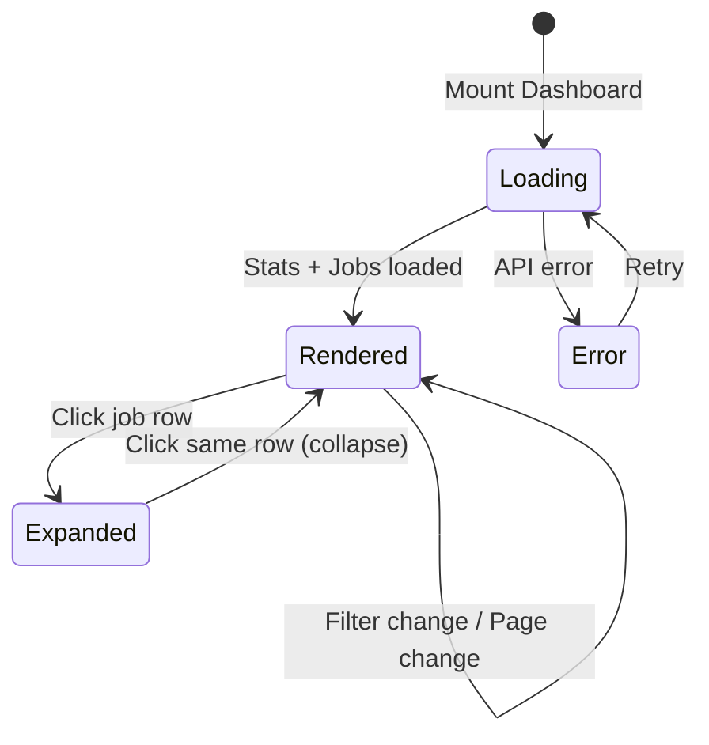

# Data Model: Dashboard Visual Redesign

**Feature Branch**: `005-dashboard-redesign`
**Date**: 2026-04-09

> The Dashboard Visual Redesign is a purely frontend, CSS/markup change. **No new database
> tables, migrations, or backend schemas are required.** All entities below are design-time
> tokens, client-side state, or UI contracts.

---

## Design Token Entities (CSS Custom Properties)

### Color Tokens

Defined in `index.css` `@theme {}` block. These replace the current Bootstrap-inspired palette.

| Token | Value | Category | Description |
|---|---|---|---|
| `--color-accent` | `#6366f1` | Interactive | Primary brand color (links, buttons, active states) |
| `--color-accent-hover` | `#4f46e5` | Interactive | Hover state for accent-colored elements |
| `--color-accent-soft` | `rgba(99, 102, 241, 0.10)` | Interactive | Subtle accent backgrounds (badges, highlights) |
| `--color-accent-glow` | `rgba(99, 102, 241, 0.25)` | Interactive | Focus rings, active indicators |
| `--color-surface` | `#f8f9fc` | Surface | Page background |
| `--color-surface-raised` | `#ffffff` | Surface | Cards, panels, table backgrounds |
| `--color-surface-overlay` | `rgba(255, 255, 255, 0.70)` | Surface | Glassmorphism card backgrounds |
| `--color-sidebar-from` | `#1e1b4b` | Sidebar | Gradient start (deep indigo) |
| `--color-sidebar-to` | `#312e81` | Sidebar | Gradient end |
| `--color-sidebar-active` | `rgba(255, 255, 255, 0.12)` | Sidebar | Active nav link background |
| `--color-sidebar-hover` | `rgba(255, 255, 255, 0.08)` | Sidebar | Nav link hover background |
| `--color-text-primary` | `#1e293b` | Typography | Body text, headings |
| `--color-text-secondary` | `#64748b` | Typography | Labels, metadata, muted content |
| `--color-text-tertiary` | `#94a3b8` | Typography | Placeholders, disabled text |
| `--color-border` | `#e2e8f0` | Structure | Default borders (cards, tables, dividers) |
| `--color-border-subtle` | `#f1f5f9` | Structure | Very subtle separators |

### Shadow Tokens

| Token | Value | Description |
|---|---|---|
| `--shadow-card` | `0 1px 3px rgba(0,0,0,0.05), 0 1px 2px rgba(0,0,0,0.03)` | Default card elevation |
| `--shadow-card-hover` | `0 10px 25px rgba(0,0,0,0.08), 0 4px 10px rgba(0,0,0,0.04)` | Hovered card elevation |
| `--shadow-auth-card` | `0 4px 24px rgba(0,0,0,0.06)` | Auth page card shadow |
| `--shadow-glow` | `0 0 20px var(--color-accent-glow)` | Accent glow effect |

### Typography Tokens

| Token | Value | Description |
|---|---|---|
| `--font-sans` | `'Inter', -apple-system, BlinkMacSystemFont, 'Segoe UI', Roboto, Helvetica, Arial, sans-serif` | Primary font stack |

### Spacing/Layout Tokens

Existing Tailwind spacing utilities are used. No custom spacing tokens are introduced.

---

## Client-Side Entity: Stats Card Configuration

Each stats card is configured with a static mapping — no new runtime data structures are needed.

| Stat Key | Display Label | Icon (Lucide) | Accent Color | Format |
|---|---|---|---|---|
| `total_jobs` | Total Jobs | `Briefcase` | Indigo (`#6366f1`) | Integer |
| `completed_jobs` | Completed | `CheckCircle2` | Emerald (`#10b981`) | Integer |
| `failed_jobs` | Failed | `AlertCircle` | Rose (`#f43f5e`) | Integer |
| `storage_used_bytes` | Storage Used | `HardDrive` | Amber (`#f59e0b`) | Formatted (bytes → MB) |
| `processed_minutes` | Processed Time | `Clock` | Cyan (`#06b6d4`) | `{n} mins` |

> These are static configuration objects in `Dashboard.tsx`, not fetched from
> any API. The numeric values come from the existing `GET /api/v1/usage` endpoint
> (type `UsageStats`). No changes to the backend or data shape.

---

## Client-Side Entity: useCountUp Hook State

### Hook Signature

```typescript
function useCountUp(target: number, durationMs?: number): number
```

### Internal State

| Field | Type | Description |
|---|---|---|
| `currentValue` | `number` (state) | The interpolated value displayed during animation |
| `startTime` | `number` (ref) | Timestamp when animation started |
| `animationFrame` | `number` (ref) | `requestAnimationFrame` ID for cleanup |
| `prefersReducedMotion` | `boolean` (derived) | From `window.matchMedia('(prefers-reduced-motion: reduce)')` |

### Behavior
- When `target` changes and `prefersReducedMotion` is `false`: animates from current value to target over `durationMs` (default: 1000ms) using easeOutCubic interpolation.
- When `prefersReducedMotion` is `true`: immediately returns `target` with no animation.
- Cleanup: cancels `requestAnimationFrame` on unmount or target change.

---

## Animation Keyframes

Defined in `index.css` as CSS `@keyframes`:

| Animation | Keyframes | Duration | Usage |
|---|---|---|---|
| `pulse-soft` | `0%: opacity 1` → `50%: opacity 0.6` → `100%: opacity 1` | 2s infinite | Active status badges (processing, transcoding, uploading) |
| `slide-down` | `0%: max-height 0, opacity 0` → `100%: max-height 300px, opacity 1` | 250ms ease-out | Expanded job detail panels |
| `stripe-slide` | (existing) `background-position: 0 → 40px` | — | Upload progress bar |

All motion-based animations are wrapped in `@media (prefers-reduced-motion: no-preference)`.

---

## State Transitions

No new state machines are introduced. The existing data flow is unchanged:



---

## Validation Rules

No new validation rules. The redesign is purely visual and does not introduce new user inputs or data constraints. All existing validation (API key name, job filters) remains unchanged.

---

## Accessibility Requirements (from FR-011, FR-012)

| Requirement | Implementation |
|---|---|
| Text contrast ≥ 4.5:1 | All text/background combinations verified against new palette (Indigo on white: 4.6:1 ✓, Slate 800 on #f8f9fc: 12.8:1 ✓, White on Indigo 950: 15.9:1 ✓) |
| Focus indicators | `focus-visible:ring-2 focus-visible:ring-accent focus-visible:ring-offset-2` on all interactive elements |
| `prefers-reduced-motion` | Motion animations opt-in only; opacity/crossfade remain for all users |
| Keyboard navigation | All existing keyboard flows preserved; no structural HTML changes |
